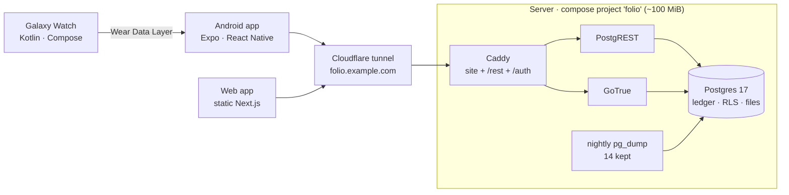

# Folio

**A private, self-hosted money app for one person: phone first, with a web app and a Galaxy Watch app on the same ledger.**

Folio tracks every rupee across bank accounts, credit and debit cards, loans and EMIs, subscriptions, deposits and investments, and money between you and the people in your life. Underneath is a real double-entry ledger, so a transfer is never mistaken for spending and a card payment is never counted twice. On top is a dark, CRED-inspired wallet built on the open NeoPOP design language, where your own card photos are the cards.

It runs on a box you own, with no third-party finance service in between. There is no sign-up and no email; a new device asks once for a passphrase, and after that it's your fingerprint.

> **Live:** https://folio.example.com &nbsp;·&nbsp; **Phone:** Android (Expo / React Native) &nbsp;·&nbsp; **Watch:** Wear OS &nbsp;·&nbsp; **Web:** static Next.js

---

## Contents

- [The app, screen by screen](#the-app-screen-by-screen)
- [How Folio thinks about money](#how-folio-thinks-about-money)
- [Privacy and security](#privacy-and-security)
- [Architecture](#architecture)
- [Repository](#repository)
- [Running your own](#running-your-own)
- [Building the apps](#building-the-apps)
- [Tests](#tests)
- [Known limitations](#known-limitations)

---

## The app, screen by screen

The phone has four tabs around a raised **＋** button: **Home · Cards · ＋ · Debit · EMIs**. Everything else is one tap away under **More** (top right on Home).

### Home: where you stand
- **Savings**: money in the bank plus deposits. Below it are **Spendable**, **Owed to you** and **You owe**.
- **The period** (Month, 3M, 6M, FY or 12M) shows income, your own spending, money paid for others, what you saved, your savings rate and spend per day.
- **Charts:**
  - **Cash flow** for the last six months;
  - **Spending rhythm**, day by day;
  - **Where it went**, by category;
  - **Paid with**, by account;
  - **Top places**.
- **Credit & obligations** shows card usage against limits, what's due in the next 30 days and what's left after it, and pending reimbursements.

### Cards: your credit cards as a wallet
- **Header:** two numbers, total **Outstanding** and **Available**.
- **Wallet:** each card is shown full-width, using the photo you uploaded of its front, or a generated face if you didn't.
- **Scrolling:** cards stack into a deck, with a bottom bar of **ALL (n)**, a thumbnail for each card and **Add**.
- **View details** opens that card's own analytics:
  - this cycle: limit used, statement due, due date, minimum due, unbilled and next statement;
  - six months of spending and its top categories;
  - an estimate of rewards and fees.

  The card's **Private details** sit underneath.
- **Presets:** five cards come ready to add, with their fees, reward rates and colours: SBI Card ELITE, IDFC FIRST Quantum+, Kiwi (YES BANK RuPay), slice UPI and Roarbank (Unity Small Finance Bank). Any other card works too.

### Debit: bank accounts, with the debit card as the face
A bank account and its debit card are **one thing**. The card is the face, the account is the money. The header shows **Balance** and **Available**, which is the balance minus what's due from those accounts in the next 30 days. View details gives money in and out for six months, top categories, and the account's private details.

### EMIs: everything that repeats
- **What's here:** loans with an EMI, plus subscriptions, each shown as a card with its amount, **due date** and **end date**.
- **Header:** **Per month**, everything normalised to a monthly figure, and **Due in 30 days**.
- **Loans:** you enter the amount, rate, **first EMI** date, **last EMI** date and the account that pays it. Folio works out the tenure, schedules every EMI and shows the amortisation (principal left, interest, the next 12 EMIs). A loan added halfway through only schedules the EMIs still to come; the earlier ones are treated as paid, so nothing shows up as overdue.
- **Subscriptions:** amount, frequency, next due date, an optional end date, and the account that pays.
- **Marking paid:** nothing is ever paid automatically. Each due date is **Mark paid** or **Skip**, and each can be confirmed exactly once.

### ＋ Add: one place for every kind of money event
- **Types:** **Spend · Income · Move · Pay card · Settle · EMI**.
- **Type it:** describe the whole thing in one line, e.g. `250 lunch on hdfc, rahul owes 125`. Folio fills in the amount, category and account, plus a split with Rahul.
- **Splits:** shares count as yours or someone else's, so paying for a friend never inflates your own spending.
- **Safety:** a duplicate warning catches the same purchase entered twice, and an **offline outbox** saves entries without a connection and sends them later. Each entry carries a one-time key, so a retry never posts twice.

### More
| | |
|---|---|
| **Ledger** | Every entry, searchable. Each entry is editable, keeps its revision history, and can be voided and restored. |
| **Grow** | Fixed and recurring deposits, mutual funds and stocks (see below). |
| **Accounts** | Banks, cash, wallets, deposits, cards and loans. Reorder, edit, archive. |
| **People** | **Owed to you** and **You owe** at a glance, grouped by person; one tap to settle. |
| **Loans & EMIs** · **Bills & autopay** | The full lists behind the EMIs tab. |
| **Settings** | Security, the private vault, devices ("sign out other devices"), watch pairing. |

### Grow: each instrument behaves like the real thing
- **Fixed deposit:** deposit, rate, start date and tenure. Folio shows the **maturity date, maturity value and interest**, using Indian bank practice: quarterly compounding for whole quarters and simple interest for any leftover months. The maths is exact integer arithmetic, with no floating point.
- **Recurring deposit:** monthly instalment, rate, start and tenure. You see the total you'll put in, the maturity date and the maturity value. The balance is the instalments you've actually recorded.
- **Mutual funds:** what you've invested so far and its current value. An optional **SIP**, **daily, weekly or monthly**, becomes a tracked obligation with reminders, paid from the bank you choose.
- **Stocks:** invested, current value, and the gain or loss in rupees and percent.

The Grow header shows **Total invested** and **Now worth**. Each card carries its own one-liner, such as `7.5% · matures 17/11/27 → ₹1,94,057` or `₹50,000 in, +₹2,470 (+4.9%) · SIP ₹2,000 monthly`.

### Reminders
Folio schedules notifications on the phone; no push server is involved. Every reminder fires **two days ahead at 9 AM IST** for:
- **due dates:** EMIs, subscriptions, bills, card payments and SIPs;
- **end dates:** the last EMI, or a subscription ending;
- **credit-card statement dates**, so you know when the bill is generated.

Reminders reschedule themselves whenever something changes and never duplicate.

### Around the phone
- **Widgets:**
  - *Folio · Balance* shows spendable money, today's spend and the next bill.
  - *Folio · Quick add* records an expense in one tap.
- **Galaxy Watch:**
  - quick add by keypad or voice;
  - today's spend, what's due, what you're owed, and balances;
  - an offline queue, so entries made away from the phone sync later;
  - a Tile and two complications (*Today's spend*, *Spendable*).

### The web app
The web app is a fuller desk view of the same ledger: dashboard, transactions, accounts, cards and statements (with CSV import and reconciliation), loans, autopay, people, analytics, reports, and CSV/JSON export. It unlocks with the same passphrase-once model, plus an optional device passkey.

---

## How Folio thinks about money

Folio is built on a few principles. Every screen agrees with every other because they all come from the same ledger.

1. **Exact money.** Amounts are `bigint` paise end to end, from the database to the UI. JavaScript floating-point arithmetic is never used for money.
2. **Double entry.** Every event is a set of postings that sum to zero. Balances are derived from postings, never stored by hand.
3. **Events are not all spending.** Transfers, card payments, loan payments, refunds, splits, reimbursements and settlements are distinct event types, so nothing is double-counted. Paying your card bill is not an expense; the purchases were.
4. **Honest net worth.** Net worth is assets plus what you're owed, minus liabilities and what you owe. A credit limit is never an asset.
5. **Reimbursements aren't income.** If a friend pays you back for dinner, your income doesn't change. Their share was never your spending in the first place.
6. **Obligations are reminders, not robots.** EMIs, bills and SIPs are tracked and reminded, never paid automatically. Each due date can be confirmed exactly once.
7. **History is kept.** Edits create revisions, voids can be restored, and an audit log records changes.

---

## Privacy and security

Folio is for one owner, and the database enforces that.

- **No sign-up, no email.**
  - A new device asks once for the owner passphrase. After that it keeps its session (on the phone, in Android Keystore-backed encrypted storage) and unlocks with fingerprint or device PIN.
  - The passphrase lives only on the server.
  - Eight wrong passphrases in 15 minutes, from anywhere, lock all sign-ins for 15 minutes.
  - Public sign-up is off, and a trigger in the database refuses a second owner even if someone gets past the auth server.
- **Row-level security everywhere.** Every table is private to its owner. Every ledger write goes through a small set of `SECURITY DEFINER` functions that validate the whole event, so a malformed or unbalanced entry can't be written.
- **A phone-only private vault.** Card numbers, account numbers, IFSC codes and UPI IDs live **only on the phone**.
  - **Never leaves the phone:** the vault is never sent to the server, the web, the watch or a widget.
  - **Encryption:** the vault is sealed with AES-256-GCM. Its key sits in Android Keystore and needs a fresh fingerprint to read; once unlocked it stays in memory for at most 60 seconds and is dropped when the app goes to the background.
  - **Backups:** an encrypted backup is protected by a passphrase you choose (scrypt).
  - **Never stored at all:** CVV, PIN and OTP. The vault refuses them by design.
- **Your files stay yours.** Card photos, logos, receipts and statements are stored privately in the database behind the same row-level security, not on any public file host.
- **Your own machine.** The server sits behind a Cloudflare tunnel with no open ports. Folio deliberately lives on a box no one else uses.

---

## Architecture



- **One origin.** Caddy serves the website and proxies `/rest/v1` and `/auth/v1`, so the browser and phone talk to a single address. The web build asks for the API on its own origin, so the same build works on any host.
- **Deliberately small.** It is Supabase's two useful parts (GoTrue and PostgREST) on plain `postgres:17-alpine`, with no Realtime and no Storage server. Apps refresh on focus, on reconnect and about every 20 seconds while visible. Small files live in a size-capped table.
- **Logic in one place.** All the money logic lives in `packages/core`, shared by phone and web: ledger, balances, recurring schedules, loans, cards, Grow maths, reconciliation, the voice parser and analytics. The database re-checks the invariants that matter.

---

## Repository

```
packages/core     the engine: money & dates, ledger, balances, position, recurring,
                  loans, cards, grow, reconciliation, dedupe, importer, voice parser,
                  analytics, vault crypto  (+ tests)
packages/api      Supabase data layer, React Query hooks, offline outbox,
                  device unlock  (+ tests)
supabase/         migrations (schema, ledger RPCs, RLS, single-owner lock, files,
                  device auth, grow) + SQL test suite
apps/mobile       Expo Router app: wallet tabs, vault, reminders, widgets, and the
                  native watch bridge (modules/folio-wear)
apps/web          Next.js 16 static export + Tailwind 4
apps/wear         Wear OS app: Gradle, Kotlin, Compose, Tile, complications (+ tests)
deploy/           compose stack, Caddyfile, migrate/backup scripts, folio.sh
```

A pnpm workspace (`pnpm install` at the root).

---

## Running your own

Everything is driven from the dev PC with `deploy/folio.sh`. It targets the server in `FOLIO_SERVER` (default `ec2-user@203.0.113.10`, key `~/.ssh/folio.pem`) and the hostname in `FOLIO_HOST` (default `folio.example.com`).

```bash
deploy/folio.sh init         # first time: sync, generate secrets on the server, route the hostname
deploy/folio.sh up           # build the site here (3 GB memory cap), sync, start, apply migrations
deploy/folio.sh web          # only build the static site into apps/web/out
deploy/folio.sh passphrase   # set or change the owner passphrase (devices stay signed in)
deploy/folio.sh status | logs [svc] | backup | anon-key
deploy/folio.sh check        # disposable copy on the server's 127.0.0.1:18090; check-down removes it
```

- **Secrets:** `init` generates every secret on the server into `~/folio/deploy/.env` (mode 600). They are never printed and never leave the box.
- **Networking:** the gateway listens on `127.0.0.1:18080` only. `server-init.sh` adds a single ingress rule for the hostname to the machine's existing `cloudflared` service and creates the DNS record.
- **Builds:** the server has 2 GB of RAM shared with other apps, so the static site is built on the PC and the server only copies files into a ~70 MB Caddy image.
- **Backups:** nightly backups land in `~/folio/deploy/backups`, with 14 kept.

**Using Supabase Cloud instead:** create a project, run `npx supabase db push`, create the owner (`owner@folio.invalid` with your passphrase) under Authentication → Users, turn off sign-ups, and point the apps at it.

| Where | Variables |
|---|---|
| Phone: `apps/mobile/.env` | `EXPO_PUBLIC_SUPABASE_URL`, `EXPO_PUBLIC_SUPABASE_ANON_KEY` (from `folio.sh anon-key`) |
| Web build | `NEXT_PUBLIC_SUPABASE_ANON_KEY`; the URL defaults to the page's own origin |
| Server: `deploy/.env` | `SITE_URL`, `POSTGRES_PASSWORD`, `JWT_SECRET`, `ANON_KEY`, `SERVICE_ROLE_KEY`, `SECRET_KEY_BASE`, `FOLIO_SINGLE_OWNER`, `DISABLE_SIGNUP` (all generated) |

---

## Building the apps

### Android

The release build runs inside a memory-capped scope (4.5 GB, no swap, one worker, arm64 only), because the dev PC is short on RAM. JDK 17 is required.

```bash
cd apps/mobile
npx expo prebuild --platform android --clean --no-install
cd android && systemd-run --user --scope -p MemoryMax=4500M -p MemorySwapMax=0 \
  env JAVA_HOME=/usr/lib/jvm/java-17-openjdk-amd64 ./gradlew assembleRelease \
  --no-daemon --max-workers=1 -PreactNativeArchitectures=arm64-v8a \
  -Dorg.gradle.jvmargs="-Xmx2g -XX:MaxMetaspaceSize=512m" -Pkotlin.compiler.execution.strategy=in-process
adb install -r app/build/outputs/apk/release/app-release.apk
```

The APK embeds the JS bundle, so Metro isn't needed. To add widgets, long-press the home screen → Widgets → Folio.

### Wear OS

The watch app must share the phone's application id (`app.folio.android`) **and its signing key** (`apps/mobile/android/app/debug.keystore`), or the Data Layer won't pair them.

```bash
cd apps/wear
JAVA_HOME=/usr/lib/jvm/java-17-openjdk-amd64 ./gradlew testDebugUnitTest assembleRelease --no-daemon --max-workers=1
# Watch: Settings → Developer options → ADB debugging + Debug over Wi-Fi
adb connect <watch-ip>:5555 && adb -s <watch-ip>:5555 install -r app/build/outputs/apk/release/app-release.apk
```

Then add the Folio Tile from the watch's tile list, and the complications from a watch face's edit screen.

---

## Tests

```bash
pnpm --filter @folio/core test     # 99 tests: ledger, money & dates, obligations, loans, cards,
                                   # Grow maths (FD/RD), reconciliation, vault crypto, edit round-trips
pnpm --filter @folio/api test      # outbox, error mapping, encoding; live round-trip when
                                   # FOLIO_IT_URL / FOLIO_IT_ANON_KEY are set
bash supabase/tests/run.sh         # every migration on a throwaway Postgres + 78 assertions run as
                                   # real authenticated users with RLS on
cd apps/wear && ./gradlew testDebugUnitTest
```

---

## Known limitations

- **No bank sync.** Statements are recorded by hand or imported from netbanking CSV. PDFs are stored but not parsed.
- **Polling, not push.** Devices see each other's changes on focus, on reconnect, or within about 20 seconds while visible.
- **Browsing needs a connection.** The phone keeps no financial data on disk except the encrypted offline outbox, the private vault, and a small widget/watch summary. Adding entries works offline.
- **Investments are manual.** Mutual fund and stock values are what you enter; there is no live NAV or price feed. FD and RD values are calculated.
- **Sideload only.** The phone and watch apps share a debug signing key, which is fine for sideloading but not for the Play Store.
- **Watch voice entry** uses the watch's own speech recogniser.
