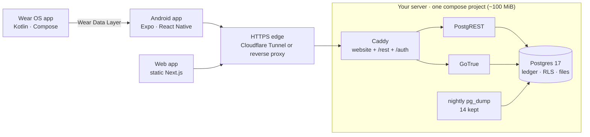

# Folio

**A private, self-hosted personal finance system: an Android app, a web app and a Wear OS watch app, all on one double-entry ledger.**

[](LICENSE)


Folio tracks every rupee across bank accounts, credit and debit cards, loans and EMIs, subscriptions, deposits and investments, plus money between you and the people in your life. Underneath is a real double-entry ledger, so a transfer is never mistaken for spending and a card bill is never counted twice. On top is a dark wallet UI built on [NeoPOP](https://github.com/CRED-CLUB/neopop-web), CRED's open-source design language, where photos of your own cards *are* the cards.

It runs on a server you own, with no aggregator or third-party finance service in between. There is no sign-up and no email: a new device asks once for a passphrase, and after that it's your fingerprint.

Built by [@jefin10](https://github.com/jefin10) as the money app I use every day.

---

## Contents

- [Features](#features)
- [Engineering highlights](#engineering-highlights)
- [Architecture](#architecture)
- [Tech stack](#tech-stack)
- [Quick start (local development)](#quick-start-local-development)
- [Self-hosting](#self-hosting)
- [Building the apps](#building-the-apps)
- [Tests](#tests)
- [Project structure](#project-structure)
- [Limitations and roadmap](#limitations-and-roadmap)
- [License](#license)

---

## Features

### On the phone

The app has four tabs around a raised **＋** button: **Home · Cards · ＋ · Debit · EMIs**. Everything else is under **More**.

- **Home: analytics.**
  - **Hero numbers:** Savings (bank plus deposits), Spendable, Owed to you and You owe.
  - **Periods** (Month, 3M, 6M, FY, 12M) show income, your own spending, money spent on others, savings rate and spend per day.
  - **Charts:** cash flow, daily spending rhythm, categories, payment methods and top places.
  - **Credit & obligations:** card utilisation and what's due in the next 30 days.
- **Cards: a wallet.**
  - **Header:** total outstanding and available credit.
  - **Cards:** each card is full-width, using a photo of its front (or a generated face). Scrolling stacks them into a deck with a thumbnail selector.
  - **View details** opens the card's statement cycle, minimum due, unbilled amount, six months of spending, top categories, and rewards and fees.
- **Debit: a bank account and its debit card are one thing.** The card is the face, the account is the money. "Available" is the balance minus what's due from that account in the next 30 days.
- **EMIs: everything that repeats.**
  - **What's here:** loans and subscriptions, each with its amount, next due date and end date.
  - **Loans:** you enter the first and last EMI dates. Folio derives the tenure and builds the amortisation schedule. A loan that's already part-way through schedules only the EMIs still to come.
- **＋ Add.**
  - **Event types:** spend, income, transfer, card payment, settlement and EMI.
  - **Type it:** write one line, like `250 lunch on hdfc, rahul owes 125`, and Folio fills in the amount, category, account and the split.
  - **Safety:** a duplicate warning, and an offline outbox that never posts the same entry twice.
- **Grow.** Each instrument behaves like the real thing:
  - **Fixed deposits:** maturity date, value and interest, compounded quarterly as Indian banks do.
  - **Recurring deposits:** total invested, maturity date and maturity value.
  - **Mutual funds:** invested amount and current value, with daily, weekly or monthly **SIPs** that become tracked obligations.
  - **Stocks:** invested amount, current value and gain or loss.
- **People.** Who owes you, whom you owe, and settling up. A friend paying you back is never counted as income.
- **Ledger.** Every entry, searchable and editable. Edits keep their revisions, and voided entries can be restored.
- **Reminders, scheduled on the phone.** Each fires two days before:
  - every due date (EMIs, subscriptions, bills, card payments, SIPs);
  - every end date (last EMI, subscription ending);
  - every credit-card statement date.
- **Private vault.** Card numbers, account numbers, IFSC codes and UPI IDs, kept on the phone only and opened by fingerprint.
- **Home-screen widgets.** A balance widget and a one-tap quick add.

### On the watch (Wear OS)

- Quick add by keypad or voice.
- Today's spend, what's due, what you're owed, and balances.
- An offline queue that syncs through the phone.
- A Tile and two watch-face complications.

### On the web

A desk view of the same ledger:
- dashboard, transactions, accounts and cards;
- statements, with CSV import and reconciliation;
- loans, autopay and people;
- analytics, reports and CSV/JSON export.

---

## Engineering highlights

- **Money is exact.** Amounts are `bigint` paise from the database to the pixel. JavaScript floating-point arithmetic never touches money. Loan amortisation and deposit compounding use integer fixed-point arithmetic (18-decimal scale) with explicit rounding.
- **Double-entry, enforced by the database.** Every event is a set of postings that must sum to zero, and balances are derived, never stored. Writes go through `SECURITY DEFINER` Postgres functions (`post_entry`, `update_entry`, `void_entry`, `confirm_occurrence`, …) that validate the whole event. A malformed or unbalanced entry cannot be written, even with the API key and a valid session.
- **Correct semantics, not just sums.** Transfers, card payments, loan payments, refunds, splits, reimbursements and settlements are distinct event types. So net worth never counts a credit limit, spending never includes a card-bill payment, and a friend's repayment is never income.
- **Security in layers.**
  - **Row-level security** on every table.
  - **Single owner:** a database trigger refuses a second owner even if sign-ups were re-enabled.
  - **Lockout:** a GoTrue password-verification hook locks all sign-ins for 15 minutes after 8 failures from anywhere.
  - **No sign-up:** a fixed internal login means there is no email address to phish.
  - **Biometric unlock:** each device keeps its session in Android Keystore-backed storage and opens with a fingerprint.
- **A vault that never leaves the phone.**
  - **Encryption:** sensitive identifiers are sealed with AES-256-GCM (`@noble/ciphers`) under a random data key held in Android Keystore with `requireAuthentication`, so reading it needs a fresh fingerprint.
  - **Memory:** the key stays in memory for at most 60 seconds and is dropped when the app goes to the background.
  - **Backups:** encrypted exports use a key derived from your passphrase with scrypt.
  - **Never accepted:** CVV, PIN and OTP fields are rejected by design.
- **Offline capture, with no double-posting.** Entries get a client-generated idempotency key before they are queued. The server has a unique index on `(owner, idempotency_key)`, so retries from the phone's outbox or the watch's queue post exactly once.
- **Native where it matters.**
  - **Watch bridge:** a Kotlin Expo module bridges the Wear OS Data Layer.
  - **Watch app:** native Kotlin/Compose, with a Tile and complications.
  - **Phone:** home-screen widgets, plus a local notification scheduler that reconciles itself, so reminders never duplicate.
- **Lean self-hosting: about 100 MiB of RAM for the whole backend.**
  - **Services:** plain Postgres 17 plus Supabase's GoTrue (auth) and PostgREST (API) behind a single Caddy origin that also serves the static web app.
  - **Left out:** the Realtime and Storage servers. Apps refresh on focus, on reconnect and while visible, and small files live in a size-capped table behind RLS.
- **One engine, shared.** `packages/core` holds the ledger, balances, recurring schedules, loans, cards, Grow maths, reconciliation, the natural-language parser and analytics. The phone and web apps share it through a pnpm workspace.
- **Tested at every layer.**
  - **Unit tests:** 99 for the engine.
  - **SQL tests:** 78 assertions that apply every migration to a throwaway Postgres and act as real `authenticated` users with RLS on, including attacks such as touching another user's data.
  - **Wear OS:** unit tests for the watch app.

---

## Architecture



- **One origin.** Caddy serves the website and proxies `/rest/v1` and `/auth/v1`. The web build calls the API on its own origin, so the same build works on any hostname.
- **No open ports.** The gateway binds to `127.0.0.1`; the public path is a Cloudflare Tunnel or your own HTTPS reverse proxy.
- **Secrets stay on the server.** They are generated there and never leave it.

---

## Tech stack

| Layer | Technology |
|---|---|
| Phone | Expo SDK 58, React Native 0.88, React 19, Expo Router, Reanimated 4, NativeWind, React Query, `@noble/ciphers` / `@noble/hashes` |
| Watch | Kotlin, Jetpack Compose for Wear OS, Tiles, Complications, Wear Data Layer |
| Web | Next.js 16 (static export), React 19, Tailwind CSS 4 |
| Engine | TypeScript, Zod, Vitest |
| Backend | PostgreSQL 17, GoTrue, PostgREST, Caddy, Docker Compose |
| Tooling | pnpm workspaces, ESLint, Gradle |

---

## Quick start (local development)

**Prerequisites:** Node 22+, pnpm 12, Docker and the [Supabase CLI](https://supabase.com/docs/guides/cli). For the Android app you also need the Android SDK and JDK 17.

```bash
git clone https://github.com/jefin10/Folio.git && cd Folio
pnpm install

supabase start                     # local Postgres + auth + API, with every migration applied
supabase status                    # note the API URL and anon key
```

Create the owner account. Open Studio at http://localhost:54323, go to **Authentication → Add user**, and use email `owner@folio.invalid` with a passphrase of your choice (auto-confirm). That passphrase is what every new device will ask for.

**Web:**

```bash
cp apps/web/.env.example apps/web/.env.local     # paste the anon key
pnpm dev:web                                      # http://localhost:3000
```

**Android** (a development build, because the app has native modules):

```bash
cp apps/mobile/.env.example apps/mobile/.env      # URL: http://10.0.2.2:54321 on the emulator, or your machine's LAN IP
pnpm --filter @folio/mobile android               # builds and installs the dev client
pnpm dev:mobile                                   # starts Metro
```

---

## Self-hosting

Any Linux machine with Docker and Compose works; 1 GB of RAM is plenty. Everything is driven from your dev machine with `deploy/folio.sh`.

```bash
cp deploy/deploy.env.example deploy/deploy.env   # FOLIO_SERVER, FOLIO_HOST, optional FOLIO_SSH_KEY

deploy/folio.sh init         # sync, then generate every secret on the server (never printed)
deploy/folio.sh up           # build the site locally, sync, start the stack, apply migrations
deploy/folio.sh passphrase   # create the owner and set the device passphrase
deploy/folio.sh anon-key     # the public key for apps/mobile/.env
```

- **Making it public:** if the server already runs `cloudflared` as a system service, `init` adds an ingress rule and DNS record for `FOLIO_HOST` automatically. Otherwise, point any HTTPS reverse proxy (Caddy, nginx, a Cloudflare Tunnel you manage) at `http://127.0.0.1:18080`.
- **Day-to-day commands:** `deploy/folio.sh status | logs [service] | backup`.
- **Test copy:** `deploy/folio.sh check` starts a disposable copy on `127.0.0.1:18090` for testing; `check-down` removes it.
- **Backups:** nightly backups go to `~/folio/deploy/backups`, with 14 kept.
- **Supabase Cloud instead:** create a project and run `npx supabase db push`. Add the owner (`owner@folio.invalid`) under Authentication → Users, turn off sign-ups, and point the apps at the project's URL and anon key.

| Where | Variables |
|---|---|
| `deploy/deploy.env` (your machine) | `FOLIO_SERVER`, `FOLIO_HOST`, `FOLIO_SSH_KEY` |
| `deploy/.env` (server, generated) | `SITE_URL`, `POSTGRES_PASSWORD`, `JWT_SECRET`, `ANON_KEY`, `SERVICE_ROLE_KEY`, `SECRET_KEY_BASE`, `FOLIO_SINGLE_OWNER`, `DISABLE_SIGNUP` |
| `apps/mobile/.env` | `EXPO_PUBLIC_SUPABASE_URL`, `EXPO_PUBLIC_SUPABASE_ANON_KEY` |
| Web build | `NEXT_PUBLIC_SUPABASE_ANON_KEY` (the URL defaults to the page's own origin) |

---

## Building the apps

### Android release APK

JDK 17 is required. The JS bundle is embedded, so no Metro server is needed.

```bash
cd apps/mobile
npx expo prebuild --platform android --clean --no-install
cd android && JAVA_HOME=/usr/lib/jvm/java-17-openjdk-amd64 ./gradlew assembleRelease \
  -PreactNativeArchitectures=arm64-v8a
adb install -r app/build/outputs/apk/release/app-release.apk
```

> **On a low-memory machine,** wrap Gradle in `systemd-run --user --scope -p MemoryMax=4500M` and add `--no-daemon --max-workers=1 -Dorg.gradle.jvmargs="-Xmx2g"`. `deploy/folio.sh web` already builds the website inside a 3 GB memory cap.

### Wear OS

The watch app must share the phone app's application id (`app.folio.android`) **and its signing key**, or the Wear Data Layer won't pair them.

```bash
cd apps/wear
JAVA_HOME=/usr/lib/jvm/java-17-openjdk-amd64 ./gradlew testDebugUnitTest assembleRelease
adb connect <watch-ip>:5555 && adb -s <watch-ip>:5555 install -r app/build/outputs/apk/release/app-release.apk
```

---

## Tests

```bash
pnpm --filter @folio/core test   # 99 tests: ledger, money & dates, obligations, loans, cards,
                                 # FD/RD maths, reconciliation, vault crypto, edit round-trips
pnpm --filter @folio/api test    # outbox, error mapping, encoding; live round-trip when
                                 # FOLIO_IT_URL / FOLIO_IT_ANON_KEY are set
pnpm db:test                     # every migration on a throwaway Postgres + 78 RLS-on assertions
cd apps/wear && ./gradlew testDebugUnitTest
```

---

## Project structure

```
packages/core     the engine: money & dates, ledger, balances, position, recurring,
                  loans, cards, grow, reconciliation, dedupe, importer, voice parser,
                  analytics, vault crypto                                     (+ tests)
packages/api      data layer, React Query hooks, offline outbox, device unlock (+ tests)
supabase/         migrations (schema, ledger functions, RLS, single-owner lock, files,
                  device auth, grow) + SQL test suite
apps/mobile       Expo Router app: wallet tabs, vault, reminders, widgets, and the
                  native Wear OS bridge (modules/folio-wear)
apps/web          Next.js static export
apps/wear         Wear OS app: Compose UI, Tile, complications           (+ tests)
deploy/           Compose stack, Caddyfile, migrate/backup scripts, folio.sh
```

---

## Limitations and roadmap

- **No bank sync.** Statements are entered by hand or imported from netbanking CSV. PDFs are stored but not parsed.
- **Polling, not push.** Devices see each other's changes on focus, on reconnect, or within about 20 seconds while visible.
- **Browsing needs a connection.** Adding entries works offline, but the phone deliberately keeps almost no financial data on disk.
- **Manual market values.** Mutual fund and stock values are what you enter; FD and RD values are calculated.
- **Sideload only.** The apps are built for sideloading; there is no Play Store listing.
- **India first.** The money is in rupees, and the institution catalog, card presets and deposit maths follow Indian conventions.

Issues and pull requests are welcome.

---

## License

[MIT](LICENSE). Use it, fork it, run your own.

Folio is a personal project and not financial advice. It is not affiliated with CRED or with any bank, card issuer or network. Bank and card names are trademarks of their owners, and the repository bundles no bank or card artwork: you upload photos of your own cards.
